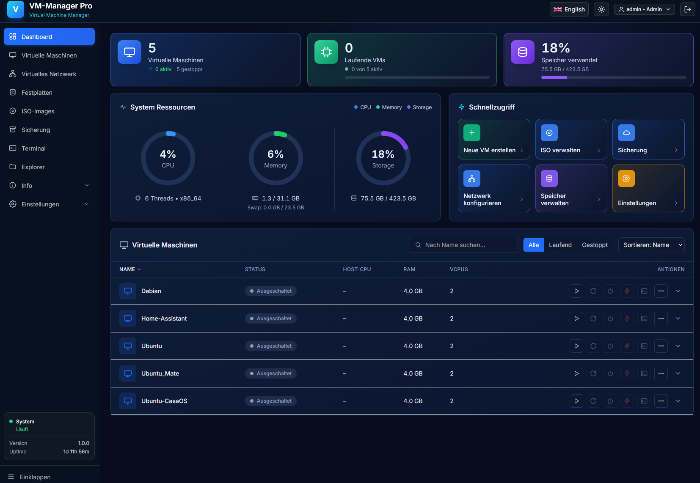
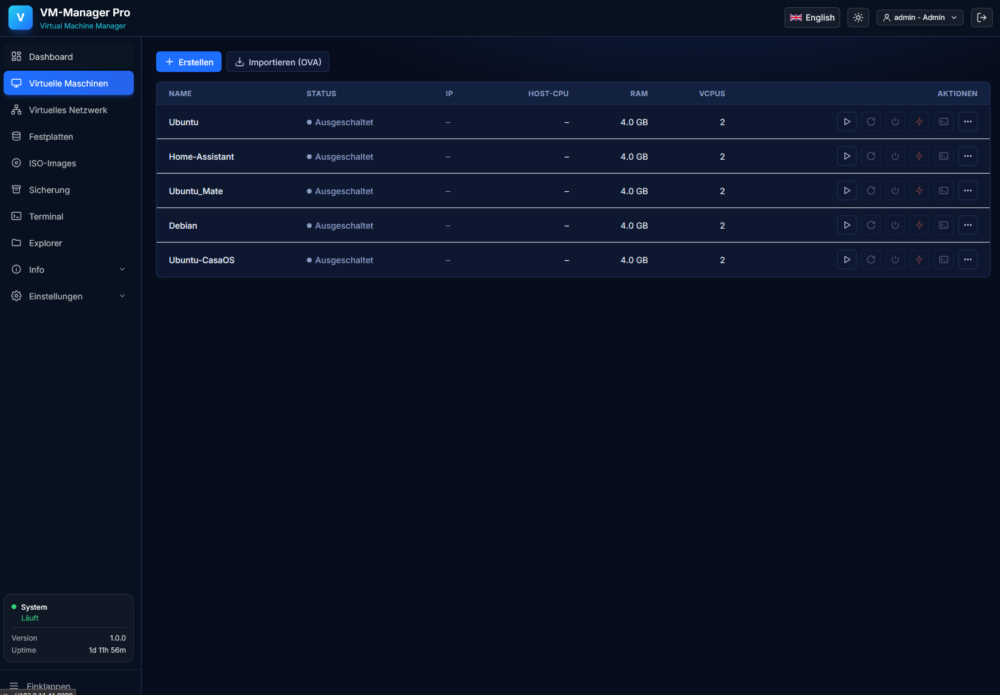
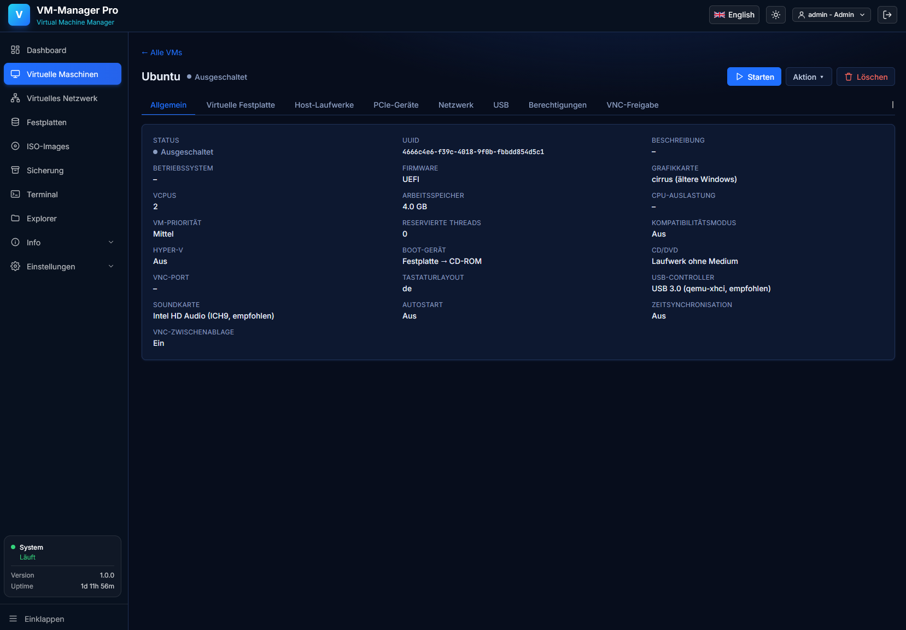
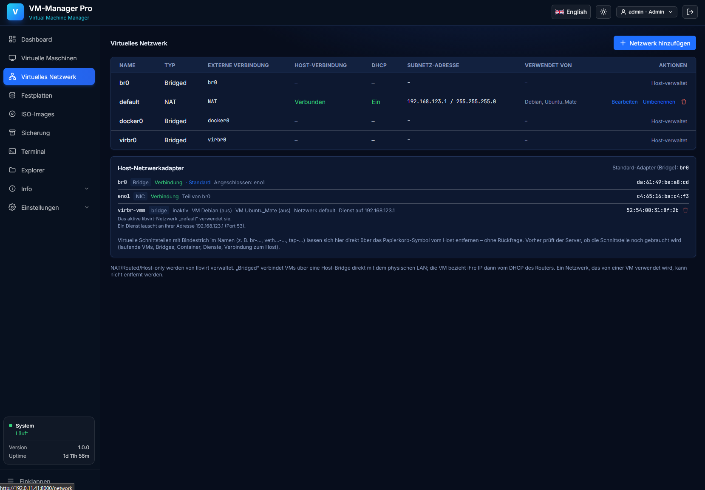
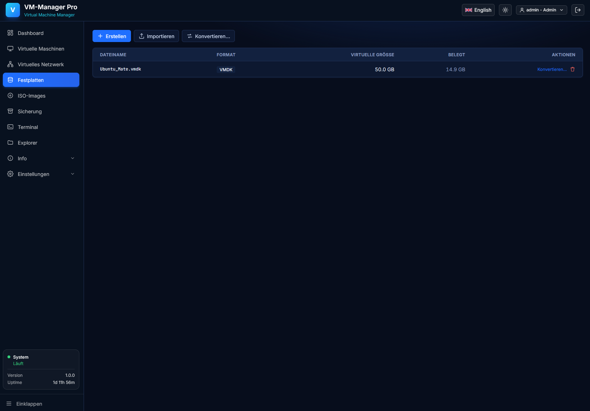
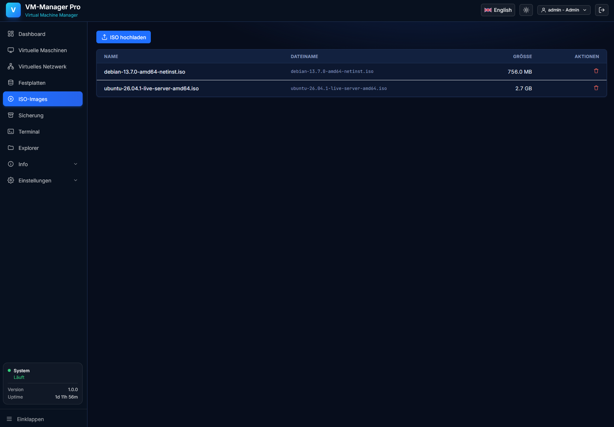
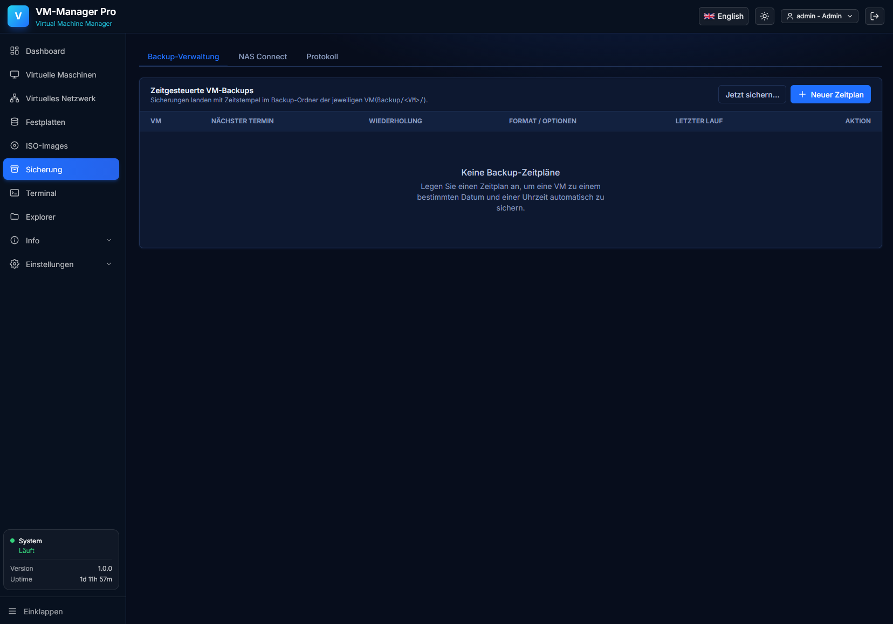
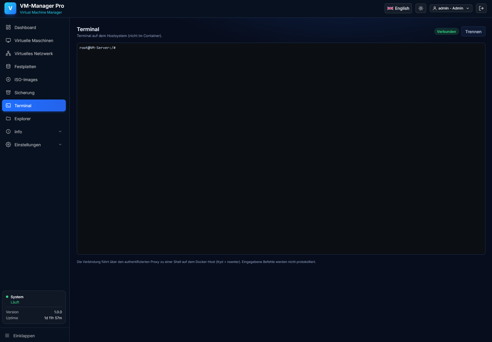
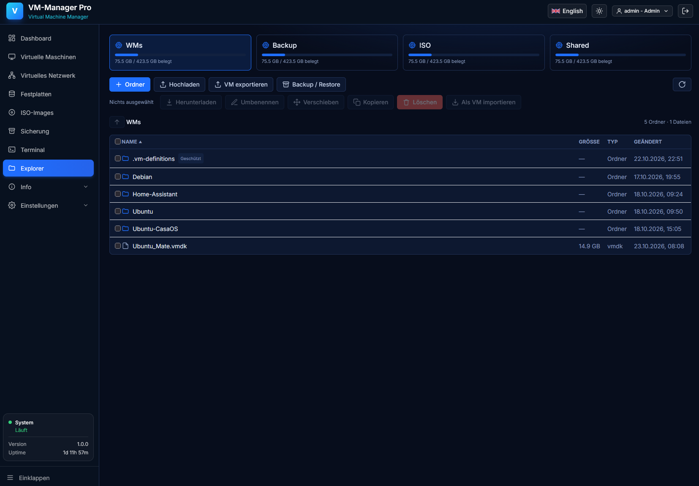

# VM-Manager Pro

**Webbasierte Verwaltung für virtuelle Maschinen auf Linux – selbst gehostet mit Docker.**

VM-Manager Pro bietet eine zentrale Oberfläche zum Verwalten von KVM/QEMU-VMs, virtueller Hardware, Netzwerken, Speicher, ISO-Dateien und Backups.

> **Hinweis:** Dieses Repository enthält die README, Screenshots und die bereitgestellte Docker-Compose-Konfiguration. Das eigentliche Container-Image `codxio/vm-manager-pro:latest` muss separat gebaut oder aus einer von dir veröffentlichten Registry bezogen werden. Die Compose-Datei lädt das Image nicht automatisch aus GitHub.

## Übersicht

- Zentrale Verwaltung von VMs über den Browser
- VM-Konfiguration für CPU, Arbeitsspeicher und virtuelle Hardware
- Virtuelle Netzwerke und Bridge-Anbindung
- ISO-Images, virtuelle Festplatten und Backups verwalten
- Datei-Explorer für die eingebundenen Speicherbereiche
- Integrierter VM-Konsolenzugriff und optionaler Host-Terminalzugriff
- Persistente Verzeichnisse für VM-Dateien, ISO-Images, Backups und gemeinsame Dateien
- Docker Compose für reproduzierbare Bereitstellung

## Screenshots

### Dashboard


### Virtuelle Maschinen


### VM-Details


### Virtuelles Netzwerk


### Festplatten


### ISO-Images


### Sicherungen


### Terminal


### Datei-Explorer


## Voraussetzungen

- Unterstützter Linux-Host mit aktivierter Hardware-Virtualisierung (Intel VT-x/VT-d oder AMD-V/AMD-Vi, abhängig von den gewünschten Funktionen)
- Docker Engine und Docker Compose v2
- KVM/QEMU-Unterstützung im Host-Kernel
- Für Bridge-Netzwerke: eine bereits auf dem Host konfigurierte Linux-Bridge, beispielsweise `br0`
- Für PCIe-Passthrough: aktiviertes IOMMU im BIOS/UEFI und passende Kernel-Konfiguration

Die Verfügbarkeit von USB-, PCIe-, GPU- und anderen Passthrough-Funktionen hängt von Host-Hardware, Kernel, IOMMU-Gruppierung und Konfiguration ab.

## Schnellstart

### 1. Dateien vorbereiten

Lege `docker-compose.yml` und `.env.example` in ein Verzeichnis auf dem Linux-Host. Erstelle anschließend die Konfigurationsdatei:

```bash
cp .env.example .env
```

Passe `.env` an deine Umgebung an. Setze insbesondere ein sicheres Administratorkennwort oder verwende die vorgesehene automatische Erzeugung eines initialen Passworts. Verwende niemals ein öffentlich bekanntes Standardpasswort.

### 2. Speicherverzeichnisse erstellen

```bash
mkdir -p WMs Backup ISO Shared
```

### 3. Image bereitstellen

Stelle sicher, dass das Image `codxio/vm-manager-pro:latest` lokal verfügbar ist. Falls du es selbst baust, verwende den Build-Prozess des zugehörigen Quellprojekts.

### 4. Host-Bridge prüfen

Die Compose-Konfiguration verwendet `network_mode: host`. Wenn VMs über eine Linux-Bridge ins LAN gelangen sollen, muss diese Bridge **vor dem Start auf dem Host** angelegt und konfiguriert sein:

```bash
ip -br link
ip -br link show br0
```

Passe `VP_BRIDGE_NAME` in `.env` an den tatsächlichen Bridge-Namen an. Ändere die Netzwerkkonfiguration bei Remote-Servern vorsichtig, um einen Verlust des SSH-Zugriffs zu vermeiden.

### 5. Starten

```bash
docker compose up -d
docker compose logs -f
```

Öffne anschließend im Browser `http://<SERVER-IP>:8000` (oder den in `VP_PORT` konfigurierten Port).

### 6. Aktualisieren und stoppen

```bash
docker compose pull
docker compose up -d
```

Wenn das Image lokal gebaut wird, führe den Build-Schritt des Projekts aus, bevor du `docker compose up -d` ausführst.

```bash
docker compose down
```

`docker compose down` entfernt den Container, nicht aber die in den gemounteten Host-Verzeichnissen gespeicherten Dateien.

## Persistente Daten

| Host-Verzeichnis | Container-Pfad | Zweck |
|---|---|---|
| `./WMs` | `/data/WMs` | Virtuelle Maschinen und VM-Dateien |
| `./Backup` | `/data/Backup` | Sicherungen |
| `./ISO` | `/data/ISO` | ISO-Images |
| `./Shared` | `/data/Shared` | Gemeinsame Dateien |

Die Datenbank und weitere Anwendungsdaten müssen ebenfalls dauerhaft gespeichert werden. Prüfe vor dem Produktivbetrieb, dass das Anwendungs-Image `/data` oder den tatsächlichen Datenbankpfad persistent speichert. Die bereitgestellte Compose-Datei bindet aktuell die vier genannten Unterverzeichnisse separat ein; falls die Anwendung ihre Datenbank unter `/data/db` ablegt, ergänze einen persistenten Mount, der mit dieser Verzeichnisstruktur kompatibel ist.

## Wichtige Sicherheitsinformationen

Die bereitgestellte Compose-Datei verwendet **`privileged: true`**, **`pid: host`** und **`network_mode: host`**. Dadurch erhält der Container weitreichenden Zugriff auf den Linux-Host. Der Host-Terminalzugriff und Hardware-Passthrough erhöhen die möglichen Auswirkungen einer Kompromittierung zusätzlich.

- Betreibe die Oberfläche nur in vertrauenswürdigen Netzen und veröffentliche sie nicht ungeschützt im Internet.
- Verwende starke, individuelle Zugangsdaten und sichere den Zugriff bei Bedarf zusätzlich über VPN oder einen korrekt konfigurierten Reverse Proxy mit TLS.
- Beschränke Firewall-Regeln auf benötigte Quellnetze und Ports.
- Aktiviere externe VNC-Freigaben nur gezielt pro VM und prüfe Firewall- sowie TLS-Konfiguration.
- Erteile keinen direkten Host-Terminalzugriff, wenn er nicht benötigt wird.
- Sichere VM-Dateien, Datenbank und Konfiguration regelmäßig und teste die Wiederherstellung.
- Prüfe die Compose-Datei vor jedem Einsatz und entferne nicht benötigte Berechtigungen, soweit die Funktionen dies erlauben.

## Konfiguration

Die wichtigsten Variablen sind in `.env.example` dokumentiert:

| Variable | Bedeutung |
|---|---|
| `VP_PORT` | Port der Weboberfläche (Standard: `8000`) |
| `VP_ADMIN_USER` | Initialer Administratorname |
| `VP_ADMIN_PASSWORD` | Optionales initiales Administratorkennwort |
| `VP_SECRET_KEY` | Optionaler, selbst gesetzter Signaturschlüssel |
| `VP_BRIDGE_NAME` | Name der auf dem Host vorhandenen Bridge |
| `VP_MOUNT_WMS` | VM-Speicherpfad im Container |
| `VP_MOUNT_BACKUP` | Backup-Pfad im Container |
| `VP_MOUNT_ISO` | ISO-Pfad im Container |
| `VP_MOUNT_SHARED` | Gemeinsamer Dateipfad im Container |
| `VP_HOST_CONSOLE_ENABLED` | Aktiviert/deaktiviert die Host-Konsole |
| `VP_VNC_SHARE_ENABLED` | Aktiviert/deaktiviert die VNC-Freigabefunktion |

Weitere Variablen – einschließlich kontrolliertem Herunterfahren, PCIe-Passthrough und Schutz vor wiederholten Anmeldeversuchen – sind in `.env.example` erläutert.

## Projektstruktur

```text
.
├── README.md
├── docker-compose.yml
├── .env.example
└── docs/
    └── images/
        ├── dashboard.png
        ├── virtuelle-maschinen.png
        ├── vm-detail.png
        ├── virtuelles-netzwerk.png
        ├── festplatten.png
        ├── iso-images.png
        ├── sicherung.png
        ├── terminal.png
        └── explorer.png
```

## Lizenz

Lizenz
LICENSE.md
Lizenz – VM-Manager Pro

VM-Manager Pro ist eine selbst-gehostete Virtualisierungs-Plattform (libvirt/KVM) und wird unter der MIT-Lizenz bereitgestellt.
MIT License

Copyright (c) 2026 XIO

Permission is hereby granted, free of charge, to any person obtaining a copy of this software and associated documentation files (the "Software"), to deal in the Software without restriction, including without limitation the rights to use, copy, modify, merge, publish, distribute, sublicense, and/or sell copies of the Software, and to permit persons to whom the Software is furnished to do so, subject to the following conditions:

The above copyright notice and this permission notice shall be included in all copies or substantial portions of the Software.

THE SOFTWARE IS PROVIDED "AS IS", WITHOUT WARRANTY OF ANY KIND, EXPRESS OR IMPLIED, INCLUDING BUT NOT LIMITED TO THE WARRANTIES OF MERCHANTABILITY, FITNESS FOR A PARTICULAR PURPOSE AND NONINFRINGEMENT. IN NO EVENT SHALL THE AUTHORS OR COPYRIGHT HOLDERS BE LIABLE FOR ANY CLAIM, DAMAGES OR OTHER LIABILITY, WHETHER IN AN ACTION OF CONTRACT, TORT OR OTHERWISE, ARISING FROM, OUT OF OR IN CONNECTION WITH THE SOFTWARE OR THE USE OR OTHER DEALINGS IN THE SOFTWARE.
Hinweise

Diese Software wird „wie besehen" (as-is) für den Eigenbetrieb (Self-Hosting) bereitgestellt. Bitte die Sicherheitshinweise in der README.md beachten, bevor die Anwendung in einem nicht vertrauenswürdigen Netzwerk exponiert wird.
Drittanbieter-Komponenten

Die Anwendung nutzt bzw. bündelt quelloffene Komponenten, die unter ihren jeweils eigenen Lizenzen stehen. Diese Lizenzen gelten unverändert fort:

    ttyd – MIT License (statisch gelinkte Release-Binary für die Host-Konsole).
    noVNC (@novnc/novnc) – Mozilla Public License 2.0 (VNC-Konsole im Browser).
    xterm.js (@xterm/xterm, @xterm/addon-fit) – MIT License (Terminal-UI).
    FastAPI, Uvicorn, SQLModel, Pydantic – MIT License.
    React, Vite, Tailwind CSS – MIT License.
    libvirt-python – LGPL-2.1-or-later.
    python-jose, bcrypt, websockets, psutil, cryptography – jeweils

BSD-/MIT-/Apache-2.0-artige Lizenzen der jeweiligen Projekte.

Das Konzept der Host-Konsole ist von ttydBridge (AGPL-3.0) inspiriert; die Umsetzung in diesem Projekt ist eigenständiger Code und übernimmt keinen AGPL-lizenzierten Quellcode. ttyd selbst steht unter der MIT-Lizenz.

Marken- und Produktnamen (z. B. VMware, VMware Workstation) sind Eigentum der jeweiligen Inhaber und werden ausschließlich zu Kompatibilitäts- und Beschreibungszwecken genannt.

---

**VM-Manager Pro – deine Virtualisierungsumgebung, zentral verwaltet.**
